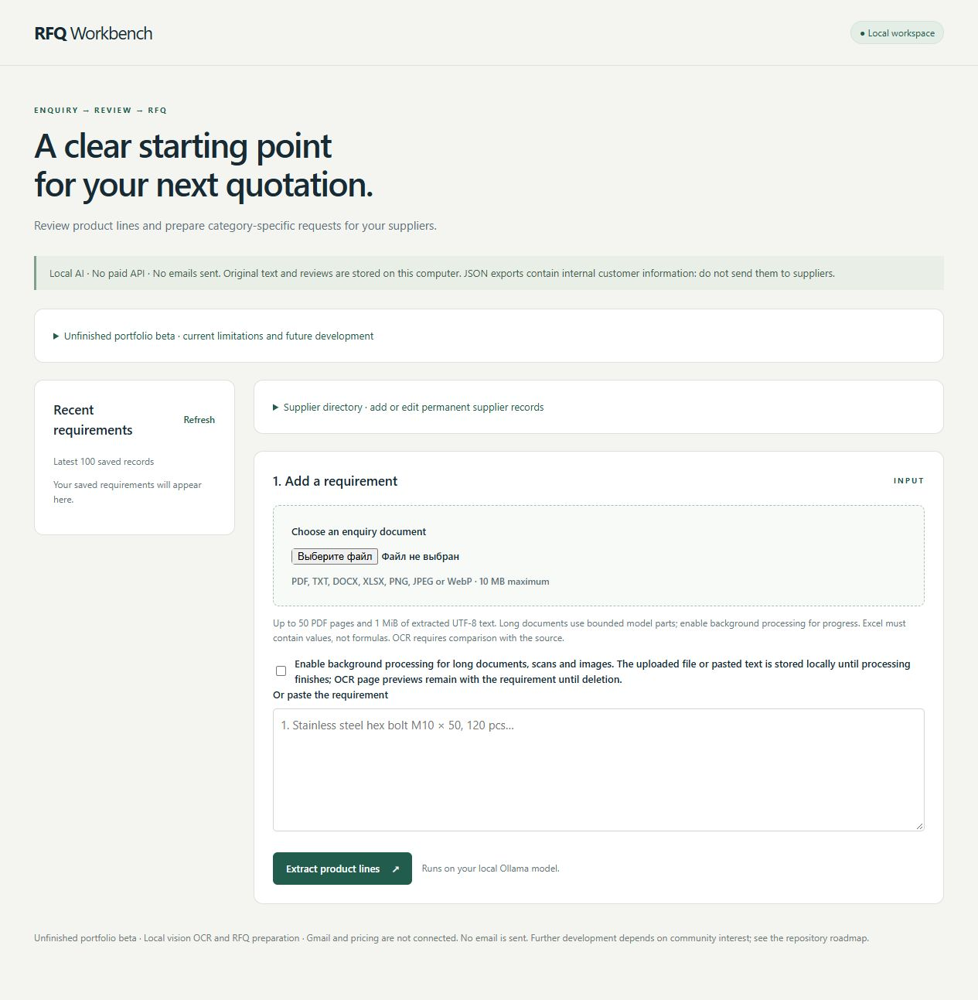
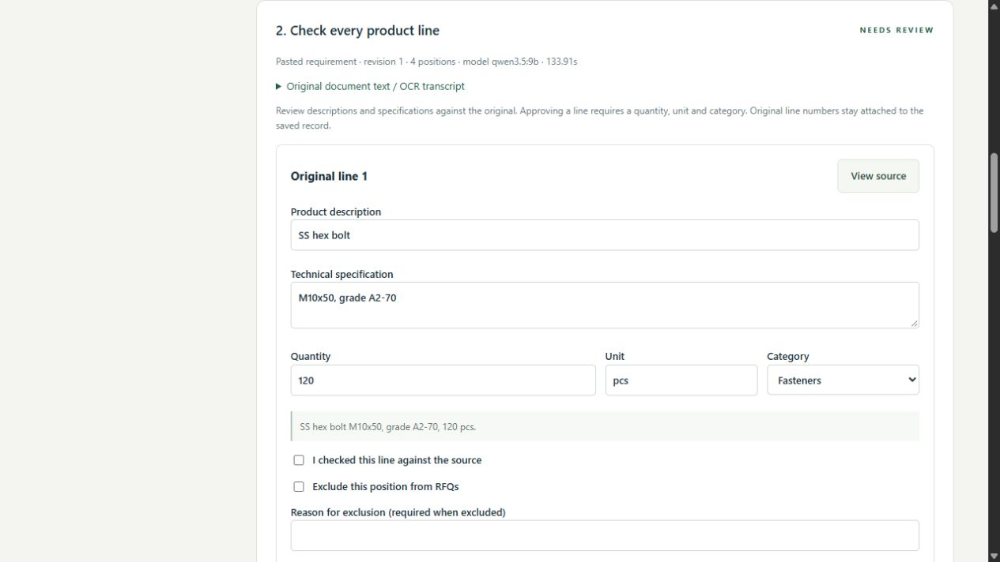
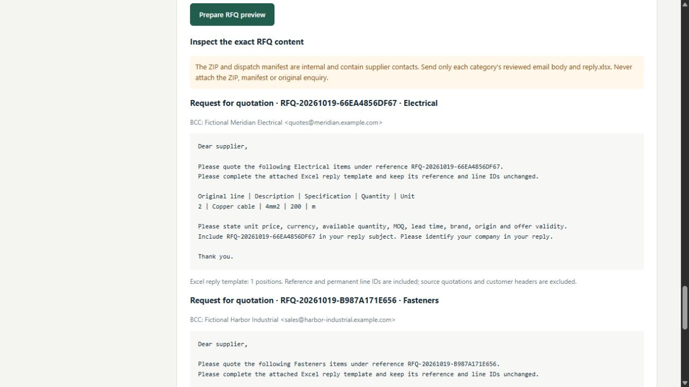

# RFQ Workbench

**Status: unfinished portfolio beta — partially implemented, local use only.** This repository demonstrates document extraction, human review and local RFQ preparation. It is not a complete enquiry-to-quotation platform or a production-ready service. See [what still needs to be built](ROADMAP.md).

**Future development:** If this repository receives enough stars and community interest, I will return to it, publish updates and complete the remaining functionality myself. There is no announced star threshold or delivery date. Starring the project helps me decide whether to prioritise it.

Start here: [installation and operation (English)](docs/INSTALLATION.md) · [пошаговая инструкция на русском](docs/LOCAL-SETUP-RU.md) · [unfinished features](ROADMAP.md).



## A look inside

Actual screenshots from the running application, using fictional enquiry data and suppliers at `example.com`. Results come from the local model and require human review. No real customer records or connected Gmail account are shown.

### Review extracted product lines

Inspect quantities, specifications, categories and source excerpts; unresolved positions remain visibly unapproved.



### Prepare supplier RFQs

Review category-specific message bodies, BCC recipients and Excel reply templates before approving a local export. This screen prepares files; it does not send email or create Gmail drafts.



[Screenshot details and reproduction](docs/SCREENSHOTS.md) · [Current features and limitations](ROADMAP.md)

Portfolio implementation of an enquiry-to-quotation workflow, developed in working, verified stages. This is an independent project: no customer prototype, production email or accounting data has been provided.

## Current stage

A working local browser application reads TXT, PDF, text/table DOCX and XLSX, PNG, JPEG and WebP, calls a real local Ollama model, and saves requirements in SQLite. Local vision transcribes scanned and mixed PDF pages and images. Reviewers can inspect stored OCR page previews, correct product fields, add missed lines with source quotations, approve complete lines, reopen records, download internal JSON and delete records. Original model responses remain separate from reviewed lines; permanent IDs and original line numbers are preserved. Optimistic concurrency rejects stale saves.

The local RFQ workflow adds a persistent supplier directory, supplier selection by category, reasoned line exclusions, revision history and a confidential-data checklist. It generates per-category email text and genuine Excel reply templates, preserves RFQ/line/supplier IDs, checks declared confidential markers in the final ZIP and decoded Office XML, and requires human preview approval before download. No email API response is simulated.

The extraction benchmark also compares real model output with labeled fictional requirements. No model response is replaced with expected answers.

The full product and Milestone 1 are **not complete**. No Gmail account has been connected, no supplier email has been sent, and no production-quality extraction threshold has been established. See `docs/PROJECT.md`.

## Run the initial benchmark

Prerequisites: Python 3.11+, Ollama running locally, and the locally installed `qwen3.5:9b` model. Model files are not included; first-time installation requires a free download through Ollama. No paid API is used.

```text
python -m pip install -r requirements.txt
python -m rfq_workbench evaluate --case demo/requirement-001.json --report data/requirement-001-report.json
```

The report records the actual model response, validation findings and field accuracy against the fixture. A failing quality target produces a nonzero exit code. The default target is 90%; success on one fictional document does not establish production accuracy.

All inference is sent to `http://127.0.0.1:11434`, not to an external model provider. The local computer must remain on while inference runs. Model speed and quality depend on hardware. No remote-hosted, always-on AI service is promised by this mode.

## Open the local application

```text
python -m pip install -r requirements.txt
python -m rfq_workbench serve
```

Open **http://127.0.0.1:8765**. Use `demo/requirement.txt` or paste a requirement. This server is bound to loopback and is designed for one local user; do not expose it to the internet. Extracted text, model output and reviews persist in `data/workbench.sqlite3`. JSON downloads contain internal customer data and are not supplier-ready exports.

For scans/images or mixed PDFs, enable local page processing and explicitly confirm storage in the upload form. The durable queue temporarily stores the original upload in SQLite until completion, failure or cancellation. Resized OCR page previews stay with the requirement for visual review; deleting it also deletes its previews/history/RFQs. Closing the browser does not stop processing. The app and Ollama must remain on; after an interrupted app restart unfinished tasks are genuinely processed again from the stored upload. Only one app instance may own a database. Up to three active jobs can be queued.

Current limits: 10 MB/file, 50 PDF pages, 25 megapixels/single-frame image, **1 MiB extracted UTF-8 text and 1,000 products**. Long documents use non-overlapping parts of at most 12,000 text bytes/eight recognised numbered source records. One continuous record/paragraph over the part budget is explicitly rejected instead of being split through its specifications. Numbered-row/paragraph boundaries are structural heuristics and still require source review. Spreadsheet formulas and embedded Office images are explicitly rejected; OCR inside DOCX/XLSX is not implemented. Saved versions predating revision-history support cannot be reconstructed. Category IDs in `categories.json` must remain stable for saved records.

Enable **background processing** for long TXT/PDF/DOCX/XLSX files or long pasted text. It provides progress for every model part. If a synchronous request needs multiple parts, the app asks you to enable background storage rather than silently retaining a file. The entire validated source is retained, partitioned without overlap, and saved only after every part succeeds. In multipart extraction the model returns a supplied source-record ID; code copies the source number/excerpt from that record. Simple unambiguous literal quantity/unit pairs are independently read from the source; ambiguous decimal/grouping formats are not guessed. Model disagreements are flagged and raw part responses remain in the analysis history.

Original numbers may repeat across pages: permanent line UUIDs and immutable source offsets distinguish them. **View source** highlights the precise source excerpt. A complete-source verification checkbox is required before a multipart result can become REVIEWED or prepare RFQs. Numbered sections with no anchored product are flagged for review; this is not proof that every numbered section is a product. Model omissions and unnumbered/complex layouts still need human review.

Local OCR uses previews with a maximum edge of 2200 pixels and has a four-minute timeout per model call. Per-page OCR response validation still has its own 16,000-character bound; dense or unreadable pages may fail explicitly. Long documents can take several minutes. No pages or text are silently truncated.

OCR is model transcription, not verified ground truth. Even an empty uncertainty list does not establish accuracy. Compare all pages and product lines with the source, then save the explicit source-verification checkbox; until then an OCR requirement remains unreviewed and RFQ preparation is blocked. A PDF with images requires page processing even when its text layer contains a header, to avoid silently ignoring scanned tables. All model HTTP calls are centralised in `local_model.py` and use the fixed loopback Ollama endpoint.

RFQ ZIPs and dispatch manifests are **internal** because they contain the BCC supplier list. Send only the reviewed email body and its `reply.xlsx`, using BCC in your mail client. Never send the ZIP, manifest, original enquiry or internal JSON. This is local preparation, not a Gmail draft or a substitute for the required Gmail integration. A changed requirement or supplier invalidates old in-app package downloads; already downloaded copies cannot be recalled.

Privacy checks reject declared/suggested names, references and monetary amounts, including case/punctuation changes and equivalent numeric formatting. They do not discover every unknown secret. The user must review the entire source, declare additional confidential data and inspect the exact outbound preview.

See [step-by-step Russian setup](docs/LOCAL-SETUP-RU.md), [manual checklist](docs/MANUAL-CHECKLIST.md), [document review evidence](docs/DOCUMENT-REVIEW-RESULTS.md) and [RFQ evidence](docs/RFQ-RESULTS.md).

## Automated checks

```text
python -m pip install -r requirements-dev.txt
python -m unittest discover -s tests -v
python tests/make_browser_inputs.py
npm install
npx playwright install chromium
npm run test:browser
```

The browser check requires the app and local Ollama to be running. It makes real model calls, uploads actual files, checks correction/save/reload/export/delete and writes reports under `data/`. It does not intercept responses or substitute model output. Set `RFQ_BASE_URL` if using a different port. Node.js and Playwright are only for development checks.

For the RFQ browser scenario use a separate local QA database, because it creates persistent fictional suppliers. In one terminal:

```text
python -m rfq_workbench serve --port 8766 --database data/qa-rfq.sqlite3
```

In another terminal run `npm run test:rfq` (defaults to port 8766). Then inspect the actual downloaded Excel files with `python tests/inspect_rfq_package.py data/rfq-browser-package.zip`. The scenario deactivates its fictional suppliers and deletes its requirement after success; the isolated QA database is ignored by Git.

For OCR checks generate fictional files with `python tests/make_ocr_inputs.py`, start an isolated server using `python -m rfq_workbench serve --port 8766 --database data/qa-ocr.sqlite3`, and run `npm run test:ocr`. It makes real vision/extraction calls for PNG/JPEG/WebP, a scanned PDF and a mixed PDF, plus a blank-image rejection check. `python tests/queue_restart.py` separately interrupts and restarts its own server on port 8771 to verify real recovery; it refuses an occupied test port. Evidence is written to ignored `data/`. See `docs/OCR-RESULTS.md`.

For long-document checks run `python tests/make_long_inputs.py`, start an isolated server with `python -m rfq_workbench serve --port 8766 --database data/qa-long.sqlite3`, and run `npm run test:long`. It uses actual long TXT/PDF/DOCX/XLSX files and real local model calls, including repeated source numbers and multiline technical details. `python tests/long_probe.py` separately checks genuine TXT/PDF extraction. See `docs/LONG-DOCUMENT-RESULTS.md`.

## Cost and ownership

No paid service, AI token purchase or subscription is enabled. Paid providers may be considered later only in a real client's own account and at that client's expense. Local operation still consumes the user's hardware and electricity. No customer document is included in this repository.

The full product still requires real Gmail/Sheets authorization and integration, embedded Office image processing, accounting import adapters, subsequent workflow stages and representative acceptance data. Those integrations will be recorded as unverified until exercised against an explicitly authorized test environment. The documented long-document structural/dense-page limits remain acceptance limits. This local SQLite stage does not establish the architecture or capacity of a multi-user production deployment.
